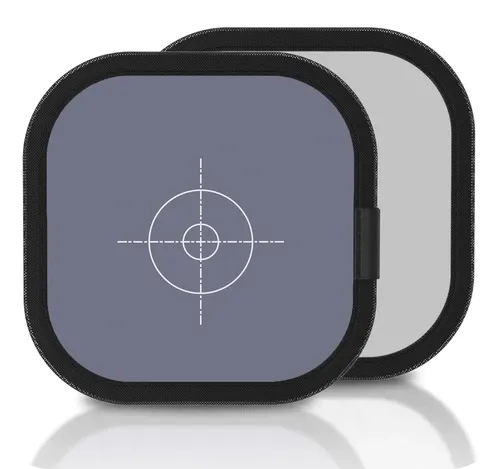
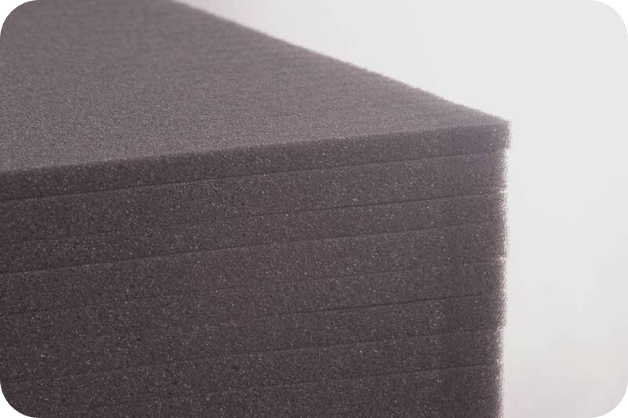
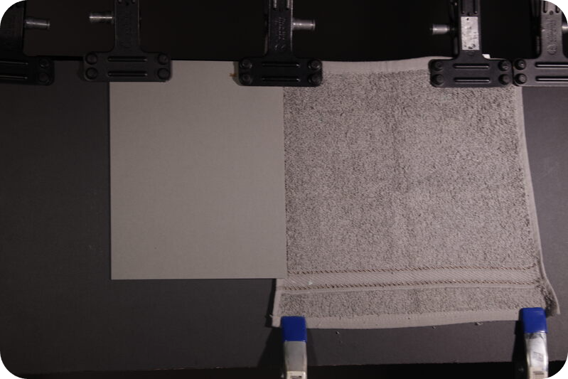
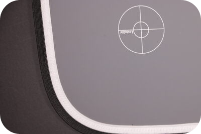

# Montaje de la escena de calibración { #escena }

La escena que permite realizar el proceso de confección de las curvas OECF, así como un proceso de caracterización adicional del equipo, resulta muy sencilla de componer en un entorno académico, pero puede resultar compleja o intimidante para personas que deban emprender solas dicho procedimiento.

Realmente es un proceso sencillo, el cual requiere de unas características algo exigentes, pero no imposibles de lograr:

## Tiempo estimado de montaje

Disponiendo de todos los elementos y el lugar idóneo, cuando se tiene experiencia en el montaje no suele requerir más de 20 minutos; normalmente lo que más cuesta de montar es la disposición de las luces, las cuales suelen resistirse más de lo deseable cuanta más prisa o menos tiempo se dispone para todo el proceso, pero con un poco de calma suele lograrse sin mayores dificultades.

## El lugar

Las capturas fotográficas deben realizarse con una luz controlada, por lo que realizar el proceso en un lugar donde la luz sea cambiante y no controlable garantiza que la inversión en tiempo no va a valer la pena, o que los resultados obtenidos van a ser imprecisos.

Lo ideal es un lugar:

- No expuesto a la luz natural cambiante.
- Con espacio y ventilación suficiente para poder estar cómodos.
- Idealmente un lugar oscuro.

> Cuando realicé este proceso por vez primera, utilicé el comedor de mi domicilio en horas de la noche. El silencio, oscuridad y calma fueron mis mejores aliados y evitaron que mi impaciencia apareciese, creo que es una buena recomendación si se realiza en un entorno fuera del aula.

## Elementos necesarios

### Tarjeta gris

No se precisa una tarjeta gris calibrada, pero disponer de ella hará que el proceso sea más rápido. Cualquier tarjeta o cartulina suficientemente gris nos servirá para este propósito y ofrecerá idénticos resultados[^gris], siempre y cuando no sea ni brillante, ni demasiado clara. Debe evitarse utilizar una tarjeta que no sea plana o que tenga algún tipo de relieve o textura.

|  | Existen algunas tarjetas grises, de fácil localización y reducido costo, las cuales presentan una diana en el centro, pensada para facilitar el enfoque.
| :---: | --- |
|  | En caso de no lograr ninguna, podría utilizarse alguna placa de espuma de poliuretano o también foam, de las empleadas para manualidades. Utilizar la menos brillante y de mayor densidad (con menos huecos) que sea posible.

> Pueden utilizarse las tarjetas con diana de enfoque, pero en todo momento se debe evitar medir en un área ocupada por esta diana. Tras realizar múltiples mediciones con exposímetro calibrado, en estudio y con luz controlada, se ha llegado a la conclusión de que dicha diana, si bien facilita el enfoque, produce una desviación típica de 1/3 de paso.

### Paño gris texturizado

Para evaluar la calidad de las texturas de cada zona lumínica se requiere un paño gris texturizado, el cual se colocará junto a la tarjeta gris. Cuanto más se parezca el paño a la tarjeta, más sencillo resultará el proceso de iluminación. Sin embargo, es casi imposible encontrar en el comercio un paño gris teñido exactamente al 18 %. Además, dado que necesitamos producir texturas para fotografiarlas, al añadir las sombras importará muy poco si encontramos o no el *paño ideal* en la tienda, ya que modificaremos su aspecto posteriormente.

Algunas recomendaciones útiles para elegir el paño son:

- No elegir un paño mucho más oscuro que la tarjeta; esto simplificará el proceso de iluminación de la escena.
- Evitar los tejidos sintéticos, ya que producen reflejos indeseados. El algodón rara vez complicará el proceso.
- No elegir paños con decoraciones que alteren la uniformidad de las texturas a lo largo de su superficie.
- Si no se encuentra un paño sin decoraciones, elegir el más neutro posible[^neutro].

### Colocación de la tarjeta y paño

Tal como puede apreciarse en la fotografía de muestra, ambos elementos deben colocarse juntos para poder fotografiarlos dentro del mismo encuadre. Las consideraciones que debemos tener en cuenta para este propósito son:

- Evitar que los adornos del paño queden justo a lo largo de todo el alto de la tarjeta gris.
- Colocar la tarjeta encima del paño y no al revés, puesto que la tarjeta suele ser más delgada; esto evitará proyectar sombras indeseadas del paño sobre la tarjeta.
- Colocar los elementos sobre una superficie o cartulina negra no brillante, lo que ayudará a lo largo de todo el proceso.
- Sujetar los elementos con pinzas en vez de cinta adhesiva, lo que garantiza poder emplear el tiempo que se necesite, ya que la cinta, especialmente la de papel, tiende a despegarse, sobre todo si las fuentes de luz generan calor sobre la escena.
- Estirar bien el paño texturizado para no producir sombras disparejas.
- Intentar colocar toda la escena lo más vertical posible.

### Fuentes de luz

El punto más complicado de lograr fuera del aula de iluminación es conseguir dos fuentes de luz estables en intensidad, neutras en temperatura de color[^luz] e iguales entre sí. Sin embargo, el proceso no está pensado para analizar el color, sino las texturas y el contraste, por lo que dos fuentes que difieran **ligeramente** en color serán más que suficientes.

Se precisan fuentes de luz potentes, ya que los parámetros de captura son algo exigentes. Típicamente se utilizan en el estudio luces LED calibradas de 300 W de potencia, aunque también se han logrado resultados extraordinarios con fuentes de 150 W. En ocasiones se han empleado cuatro fuentes de luz menos intensas, con resultados igualmente excelentes que no demeritaron el análisis en absoluto.

Conviene recordar que, cuantas más luces se utilicen, más lento será el proceso de colocación de las mismas.

## Instrumento para la medición de la luz

Lo ideal es contar con un exposímetro profesional calibrado de luz puntual; no obstante, si no se dispone de uno, puede utilizarse la medición puntual de la cámara. La medición evaluativa, ponderada al centro o con predominancia al centro no servirá para este propósito.

Utilizar una única cámara conlleva un riesgo: si el exposímetro de la cámara presenta alguna desviación, esta se repercutirá en toda la serie. Si la actividad se realiza en un taller donde no se cuente con un exposímetro calibrado, aún puede lograrse un buen resultado si previamente se realiza un proceso de promedio con los exposímetros de las cámaras de los participantes.

|  | Si va a utilizar una tarjeta gris con una diana de enfoque, mida entre el borde de la tarjeta y la diana, sin que la cinta negra ni la diana de enfoque queden dentro del punto de medición.  Es crucial evitar medir en la zona indicada, a fin de obtener una respuesta sin desviaciones por parte del software.
| :---: | --- |

## Notas a pie de página

[^gris]: En este proceso no se pretende fotografiar la tarjeta tal como se percibe, sino forzarla a comportarse como una tarjeta gris al 18 %. Aunque pueda parecer un error, lo que se busca medir es la diferencia de captura de luz, expresada en pasos fotográficos, por lo que cualquier tarjeta gris servirá para este propósito. Si se desea un resultado altamente preciso y exento de controversia, es preferible utilizar una tarjeta gris calibrada y garantizada al 18 %.

[^neutro]: En la imagen de muestra puede observarse un paño de baño típico. Se eligió aquel cuyas decoraciones quedaban más cerca del borde y más lejos del centro.

[^luz]: Dos luces pueden tener la misma temperatura de color y no ser igual de neutras, porque esa temperatura solo describe el eje cálido-frío. Para este procedimiento lo esencial es que la intensidad se mantenga estable durante toda la serie.