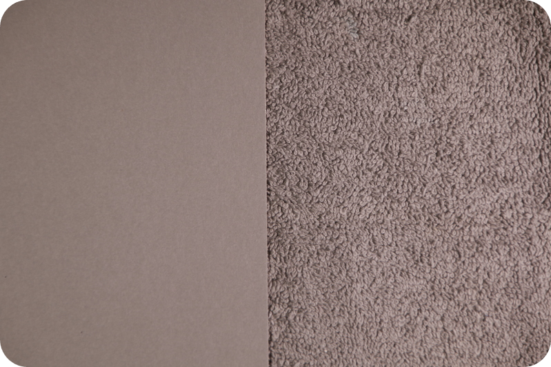

# Iluminación de la escena { #iluminacion_escena }

Esta parte es la más importante, la más delicada y la que suele ocupar la mayor parte del tiempo.

## Objetivo a lograr

El objetivo es iluminar tanto el paño como la tarjeta gris de modo que ambos ofrezcan la misma respuesta en la medición. Esto es muy sencillo de enunciar, pero suele resultar más problemático de lo que parece.

Si ambos lados ofrecen mediciones diferentes, no se logrará ningún resultado aceptable, y no existe un mecanismo automático capaz de detectar que la iluminación ha resultado desigual; el software intenta analizar las capturas y determinar si ambas zonas recibieron la misma luz, pero si bien el análisis del software es muy minucioso, no puede determinar cómo la cámara o el exposímetro unifican las zonas iluminadas con las sombras del paño gris, las cuales resultan cruciales para evaluar las texturas.

Por otra parte, de nada sirve tener un paño iluminado de manera tan perfecta que no ofrezca sombra alguna, ya que esto acabaría con las texturas, que son justo lo que se desea evaluar.

> No es necesario repartir la escena a mitades perfectas del encuadre; el paño gris se utilizará para un análisis humano de textura y la tarjeta para un análisis matemático. Es preferible una mayor cantidad de tarjeta gris en el encuadre si esta presenta impedimentos para su neutralidad (diana de enfoque, manchas, etc...). El software puede trabajar con imágenes que supongan 2/3 de tarjeta y 1/3 de paño gris.

## Problemas a evitar

- Diferencias de medición entre ambos elementos.
- Diferencias de medición entre el centro y los extremos de la escena.
- Área oscura en la transición entre el paño y la tarjeta[^trans].
- Manchas en la tarjeta gris.
- Sombras del paño sobre la tarjeta gris[^sombra].
- Utilizar una tarjeta gris con diana y mezclar o dejar muy juntos la cinta negra con el paño gris[^diana].
- Medir exclusivamente la frontera entre ambos elementos.
- Luz parásita en el espacio de trabajo.
- Reflejos sobre los elementos.
- Mezclar fuentes de luz de distinta naturaleza (LED y halógena)[^led].
- Parpadeo (flicker) en las fuentes LED[^led2].

## Cosas que suelen funcionar

- Utilizar dos fuentes de luz, una a cada lado de la escena.
- Separar o acercar cada fuente de luz de forma distinta (normalmente, más alejada la del lado del paño).
- Medir entre la transición de los elementos y su centro (que es lo que se va a fotografiar), en vez de medir el centro y bordes de cada elemento.
- Alejar las fuentes lo suficiente para que la caída de luz entre el centro y los bordes de la escena sea mínima (ley del inverso del cuadrado).
- Repetir la medición varias veces en cada punto y promediar, especialmente si se usa el exposímetro de la cámara en lugar de uno externo calibrado.
- Realizar una toma de prueba completa antes de la sesión definitiva. Esto permite detectar problemas de iluminación, enfoque o configuración antes de invertir tiempo en el proceso completo[^truco].

> No intentar colocar las luces de manera simétrica en posición; se busca simetría en el resultado no en su ubicación.

## Notas a pie de página

[^trans]: Es muy fácil concentrarse en medir ambas áreas y dirigir el haz de luz de modo que ambos elementos queden iluminados en su centro; sin embargo, lo que se pretende es que no exista transición alguna, en términos de intensidad y medición de luz, entre ambas áreas.

[^sombra]: Funciona mucho mejor colocar la tarjeta sobre el paño, aunque depende en gran medida del paño y de la tarjeta utilizados.

[^diana]: En este caso es mejor colocar el paño sobre la tarjeta para tapar el borde negro. No obstante, en esa disposición debería colocarse un elemento de igual grosor al otro lado del paño, a fin de evitar que este quede inclinado y ofrezca una respuesta a la iluminación degradada en lugar de constante.

[^led]: Aunque el proceso no analiza el color, sí pueden introducir diferencias de respuesta espectral que afecten al contraste capturado.

[^led2]: Algunas fuentes LED parpadean a frecuencias que el ojo no percibe pero que la cámara sí registra, generando variaciones entre tomas idénticas e incluso entre áreas de la misma toma fotográfica.

[^truco]: Se puede capturar en una fotografía cada elemento y analizarlo en un editor gráfico, analizar el histograma, el cual deberá estar lo más unificado y centrado posible, y analizar la imagen por áreas de iluminación en un software de edición fotográfica. Este sub procedimiento, aunque tedioso, suele ayudar mucho a las personas sin acceso a un exposímetro calibrado o con poca experiencia en iluminación.
