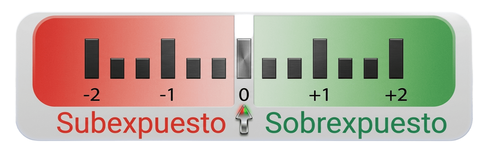

# Calibración y/o caracterización del exposímetro

## Método

Una vez lograda la iluminación correcta, puede caracterizarse o calibrarse el exposímetro de la cámara comparando la medición obtenida en la cámara con la del [resultado fotométrico][resultado_fotometrico].

El procedimiento es muy sencillo:

- Colocar en la cámara los valores fotométricos determinados en la escena de iluminación.
- Programar el exposímetro en medición puntual[^expo].
- Medir un área de la tarjeta gris que no contenga manchas, diana de enfoque, borde negro ni ningún otro elemento que no sea, exclusivamente, un área gris.
- Realizar la medición con el exposímetro de la cámara.
- Analizar si el exposímetro se sitúa en su valor central (0) o cuánto se desvía de él.

## Análisis de los datos

{.centrada}

El análisis es muy sencillo:

- Cuanto más se desvíe la medición del centro hacia la izquierda, más se estarán sobrexponiendo las fotografías al medir con ese valor.
- Cuanto más se desvíe la medición del centro hacia la derecha, más se estarán subexponiendo las fotografías al medir con ese valor.

Aunque a primera vista resulte contraintuitivo, el lugar donde marque el exposímetro en el visor será el tercio de paso exacto en el que este mida gris al 18 %[^gris]. Es decir, si al medir se coloca la aguja en 0, se está aplicando precisamente esa sobre o subexposición: el procedimiento determina cuánto se desvía el exposímetro de la medición ideal, y el efecto se hace notorio cuando el fotógrafo utiliza el centro (y no el punto marcado por este análisis) como referencia para medir la luz neutra.

## Cómo utilizar el resultado

- Si se dispone de una cámara Nikon[^Nikon], puede utilizarse la compensación de la exposición para modificar el comportamiento del exposímetro en medición puntual. En esta marca, y en otras que ofrezcan este comportamiento, es posible calibrar el equipo.

- La marca Canon[^Canon] no ofrece esta posibilidad en sus equipos. Con cámaras de este tipo, deberá considerarse como neutro el punto que el experimento de calibración haya indicado como lugar de medición. Estas cámaras solo permiten caracterizar sus exposímetros, no calibrarlos.

- La medición no manual de la luz queda fuera del interés del autor y del alcance de este trabajo.

## Notas a pie de página

[^expo]: Conviene insistir una vez más en la imposibilidad de obtener resultados válidos con cámaras que no dispongan de este método de medición.

[^gris]: Debe recordarse que la tarjeta gris, sea cual sea su tono, se ha iluminado y se ha determinado (aunque sea de forma artificial) que su valor de reflectancia lumínica medida es el que se considerará gris neutro. Si se desea evitar controversia o dudas al respecto, se recomienda elegir una tarjeta gris calibrada.

[^Nikon]: Es una marca registrada de *Nikon Corporation*.

[^Canon]: Es una marca registrada de *Canon Kabushiki Kaisha*.
