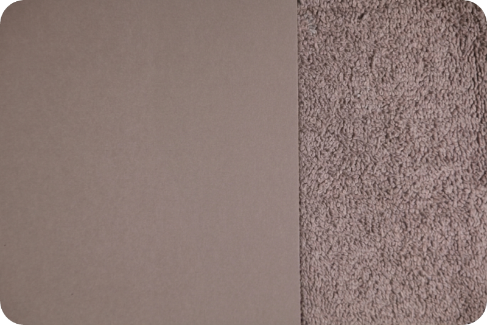

# Conjunto de capturas

## Aspectos generales

Para el análisis fotográfico posterior se requieren las siguientes capturas:

- 31 capturas del paño y la tarjeta gris, ordenadas según las 31 zonas lumínicas de la adaptación digital del sistema de zonas de [Ansel Adams](https://www.anseladams.com).

- Dos capturas con la tapa del objetivo colocada, para impedir la entrada de luz, las cuales van a permitir medir el nivel de negro y de ruido del sensor.

- Varias capturas con distintos balances de blancos, las cuales permitirán determinar los Kelvin exactos que registra la cámara en cada uno de ellos.

El procedimiento requiere un tiempo considerable. Si durante ese periodo la intensidad de la luz varía, el tiempo invertido no habrá servido de nada.

Si se utiliza luz halógena o incandescente, será necesario disponer de un instrumento de medición que verifique de forma constante que la intensidad de la luz no ha variado. La luz LED es más estable, siempre que no presente parpadeo (flicker). Conviene recordar que algunas fuentes LED parpadean a frecuencias que el ojo no percibe, pero que la cámara sí registra, lo que genera variaciones entre tomas idénticas.

Es conveniente activar el mecanismo que nuestra cámara (sobre todo las sin espejo) disponga para contrarrestar tal efecto.

## Encuadre { #encuadre_escena }

El encuadre puede realizarse de dos maneras: haciendo que cada elemento ocupe la mitad del encuadre o dejando la tarjeta gris ocupar 2/3 de este.

|  | 
| :---: | --- |

La tarjeta gris se va a utilizar para los cálculos del software, mientras que el paño gris va a servir para analizar visualmente el conjunto de texturas. Con cámaras con más de 20 Mpx se recomienda que la tarjeta gris ocupe 2/3 del encuadre.

Para el procedimiento es indiferente colocar la tarjeta gris en el lado izquierdo o derecho del encuadre.

## Tener presente

- Ante la duda, repetir la toma, no la secuencia.
- Ante la incertidumbre, repetir el procedimiento y borrar las fotografías anteriores.