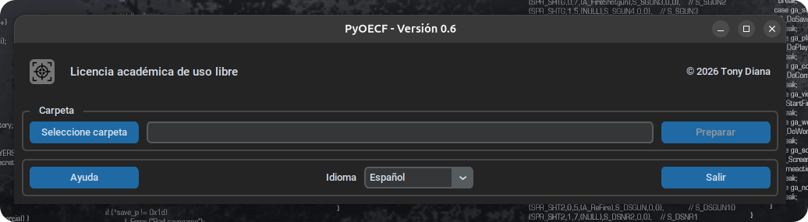
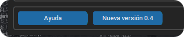
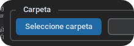
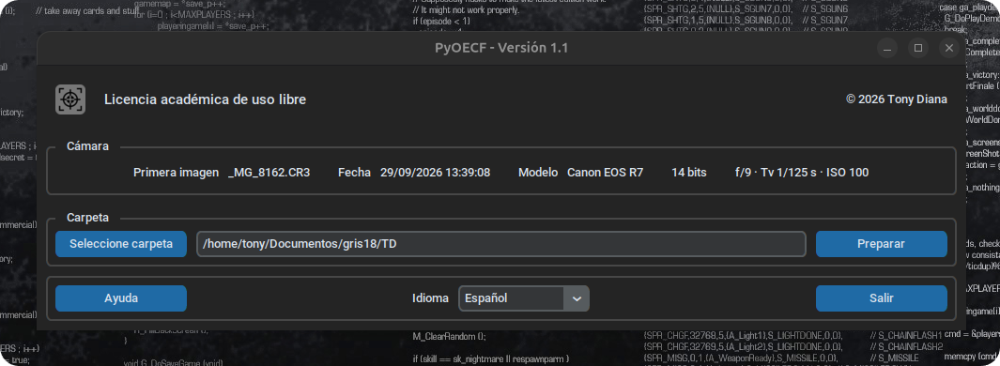
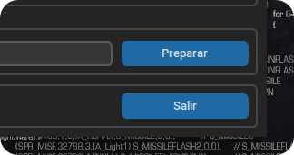
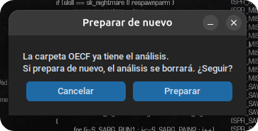

# Ejecución

El software está pensado para resultar intuitivo para cualquier usuario con conocimientos básicos en el uso de la informática.

|  | El enlace a la ayuda le llevará a la página web donde se encuentra el manual de uso. La documentación disponible corresponde siempre a la última versión publicada.
| :---: | --- |
|  | Cuando se publique una nueva versión, aparecerá un botón junto al de ayuda que le llevará a la página de descargas de la siguiente versión.
|  | Debe seleccionar la carpeta con la que va a trabajar.

La carpeta puede ser una de estas:

- **La carpeta de las fotografías originales**, para prepararlas.
- **La carpeta `OECF`** que crea el programa dentro de ella, para volver a analizar una serie ya preparada, aunque ya no estén los originales.
- **Una carpeta con solo `estudio.json` y las TIFF del revelador**, para analizar únicamente el revelado (ver [Análisis del revelado][revelado]).

Una vez seleccionada la carpeta, aparecerá automáticamente información relevante sobre las tomas:

- Nombre del archivo de la primera toma.
- Fecha y hora de captura, según los datos de la cámara.
- Modelo y marca de la cámara.
- Profundidad de bits de los archivos RAW.
- Valores fotométricos, que se interpretarán como ZV; deberían coincidir con los descritos en el capítulo de [resultado fotométrico][resultado_fotometrico].

El usuario debe verificar que esta información es correcta antes de lanzar el proceso de preparación de las fotografías.

|  | Los botones de la derecha cambian según la carpeta elegida: **Preparar** con las fotografías originales; **Analizar** con una carpeta `OECF` ya preparada; y, si ya hay análisis, **Abrir resultados** o, si hay exportaciones del revelador, **Analizar revelado**.
| :---: | --- |
|  | Si el procedimiento se lanza por segunda vez (se explicará más adelante la necesidad), aparecerá un aviso antes de volver a lanzar el proceso desde el principio.
