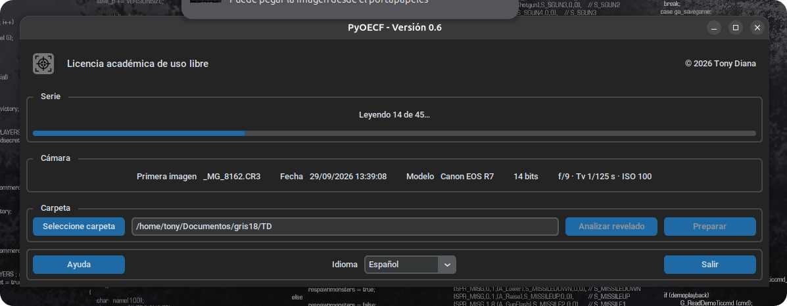
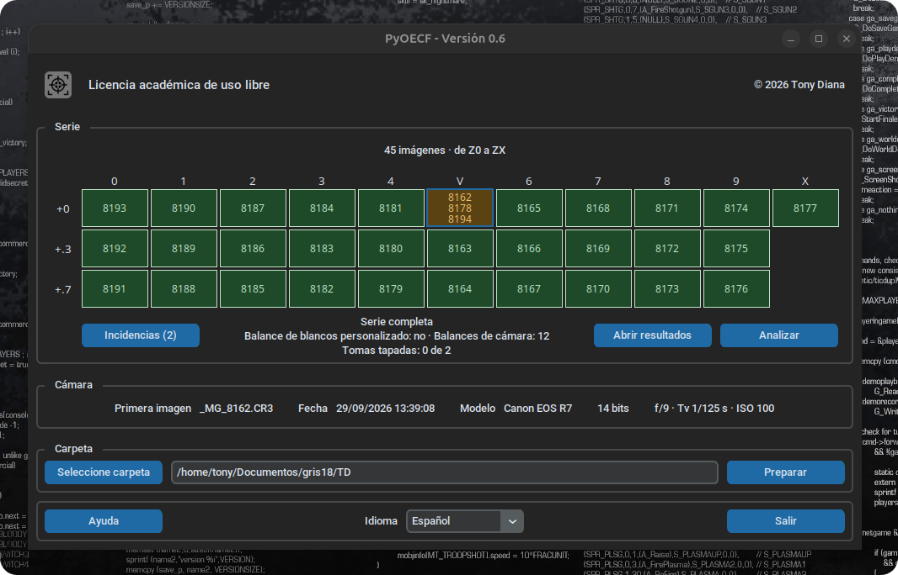
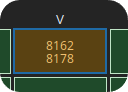
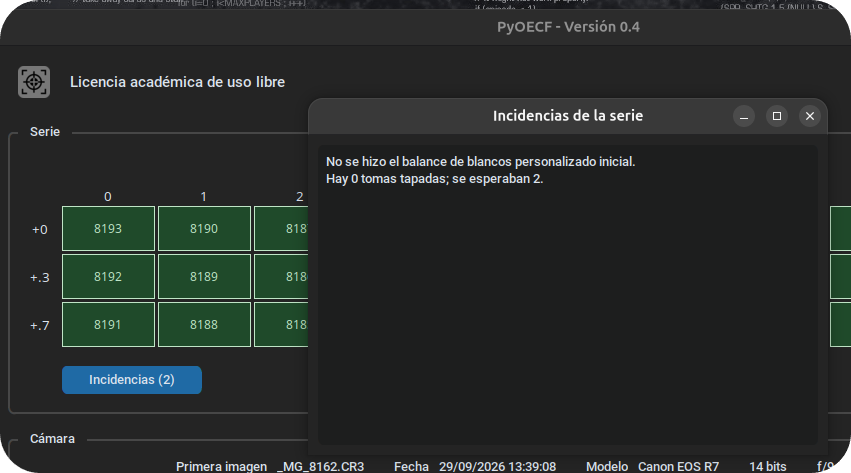
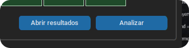

# Preparación de las fotografías

## Procesamiento

Mientras se preparan las fotografías aparecerá una barra; esta permite ver la velocidad del proceso y estimar el tiempo restante antes de la siguiente fase[^contador].

## Resultados

Una vez preparadas las fotografías aparecerá un cuadro con información e incidencias encontradas durante el proceso.

|  | N.º de fotografías analizadas y zonas lumínicas encontradas.
| :---: | --- |
|  | Información sobre la serie y resumen de incidencias.
|  | Lanzador del informe de incidencias.
|  | Casillas con zonas lumínicas con incidencias.

## Incidencias

Se pueden consultar las incidencias encontradas para decidir si continuar el proceso o mejorar algún aspecto y repetirlo.

## Consulta previa de los resultados del análisis

Tras realizar el proceso de preparación, el software habrá generado la carpeta `OECF` con todas las imágenes que servirán para realizar el análisis final. Esta carpeta se encuentra dentro de la carpeta de las fotografías originales. Las fotografías originales permanecen intactas: el software trabaja siempre sobre copias y, a partir de este momento, ya no las necesita. Pueden guardarse en otro lugar o borrarse: para volver a analizar la serie bastará con seleccionar la carpeta `OECF`.

En este punto se habrá activado un botón al lado al que lanza el proceso de análisis, el cual permitirá abrir la carpeta y consultar su contenido.

{ .centrada }

El contenido de esta carpeta se describe en [Archivos en disco][disco].

## Notas a pie de página

[^contador]: No es recomendable utilizar una llave USB para realizar el proceso, y mucho menos hacerlo directamente desde la tarjeta de memoria de la cámara, pero en un entorno académico con varios estudiantes, es habitual recurrir a uno de estos soportes. Conviene tener presente que el proceso podría ser más lento de lo habitual si se decide utilizarlos.
