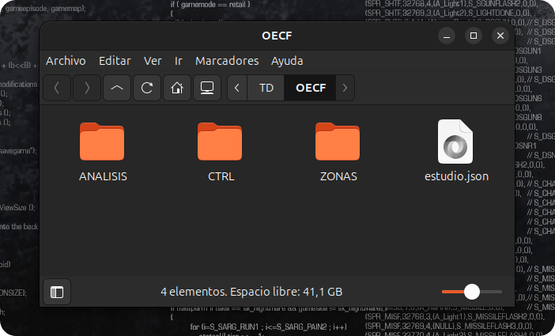

# Archivos en disco { #disco }

Al preparar las fotografías, el software crea la carpeta `OECF` dentro de la carpeta de las fotografías originales.

El contenido de esta carpeta está compuesto por los siguientes elementos:

- Un archivo estudio.json; su contenido no está pensado para ser consultado por humanos, y modificarlo comprometerá el proceso de análisis.

- La carpeta ZONAS, con las 31 fotografías renombradas según la zona lumínica a la que corresponden: `Z00`, `Z00-3`, `…`, `Z10`. En ella se guardarán más adelante las exportaciones del revelador (véase [Análisis del revelado][revelado]).

- La carpeta `CTRL`, con las tomas de control:

    - Una por cada balance de blancos capturado. El nombre de estos archivos comienza con `WB` y continúa con el nombre que asigna la cámara, en inglés[^BW]; los de temperatura de color fijada a mano llevan además los Kelvin, por ejemplo `WB-01-KELVIN-5600K`.

    - `WB-CTRL`: la fotografía de la tarjeta gris utilizada para personalizar el balance de blancos, si se realizó.
    - `ZV-INI`, `ZV-MEDIO` y `ZV-FIN`: las ZV del inicio, del cambio de dirección y del final de la serie, que permiten comprobar que la luz no cambió.
    - `DARK-1` y `DARK-2`: las tomas con la tapa puesta, si se realizaron.
    - El archivo `incidencias.txt`, con las incidencias en prosa, pensado para ser consultado, analizado, borrado o modificado sin problema[^inci].

- La carpeta `ANALISIS`, vacía hasta realizar el análisis: en ella se guardarán sus resultados (ver [Primeros resultados del análisis][resultados]).

Si alguna fotografía se repitió durante la captura, solo se habrá copiado la última.

```text
TD/                         ← carpeta de las fotografías originales
├── _MG_8162.CR3
├── …
├── _MG_8206.CR3
└── OECF/
    ├── estudio.json
    ├── ZONAS/
    │   ├── Z00.CR3
    │   ├── Z00-3.CR3
    │   ├── Z00-7.CR3
    │   ├── …
    │   └── Z10.CR3
    ├── CTRL/
    │   ├── WB-01-KELVIN-5600K.CR3
    │   ├── …
    │   ├── WB-08-FLASH.CR3
    │   ├── ZV-INI.CR3
    │   ├── ZV-MEDIO.CR3
    │   └── incidencias.txt
    └── ANALISIS/
        ├── PyOECF.xlsx
        ├── PyOECF.pdf
        ├── Soportes100.psd
        └── Soportes25.psd
```

{ .centrada }

> **NO DEBE MANIPULAR, BORRAR NI RENOMBRAR NINGUNO DE ESTOS ARCHIVOS.** Lo único que debe añadirse son las exportaciones del revelador, en la carpeta `ZONAS`.


## Notas a pie de página

[^BW]: Cada marca tiene su propia manera de indicar este contenido. En ocasiones podría darse el caso de no poder ofrecer un nombre correcto por ser desconocido para el programa, por lo que en este escenario se asignará el número o el nombre/valor que el fabricante de la cámara utilice para identificarlo.


[^inci]: Su contenido es idéntico al mostrado en la ventana de incidencias.
