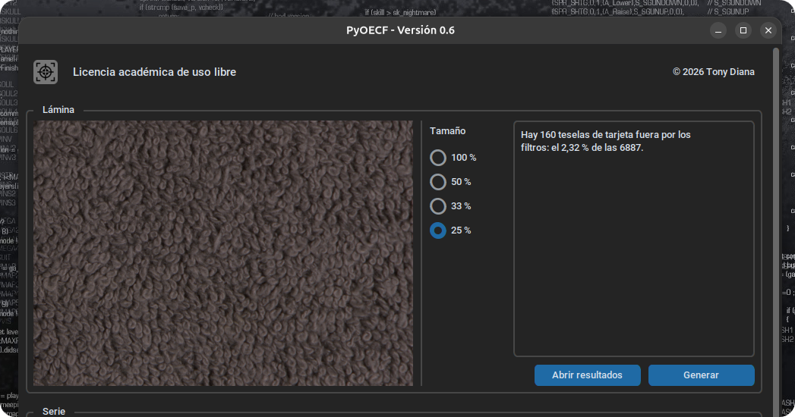
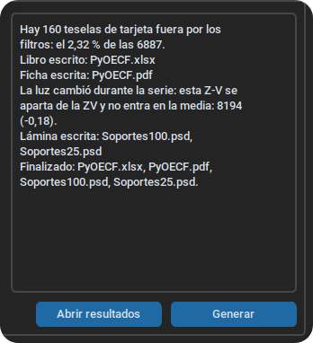

# Análisis de los datos

Una vez preparados los datos, puede procederse a su análisis. Es un proceso muy sencillo, ya que el software realiza todo el trabajo.

Basta con indicar el tamaño al que se desean reducir las capturas del paño gris para confeccionar la plantilla de calibración de soportes.

{ .centrada }

Se recomienda utilizar un tamaño acorde con la resolución de la cámara. Lo idóneo es que la textura no sea demasiado grande ni demasiado pequeña, de modo que pueda apreciarse bien en un teléfono móvil, en una pantalla de computadora o en una impresión en papel.

- Hasta 10 Mpx: 100 %.
- Entre 10 Mpx y 18 Mpx: 50 %.
- Entre 18 Mpx y 22 Mpx: 33 %.
- Superiores: 25 %.

> Esta tabla es una sugerencia; será el usuario el que seleccionará el tamaño deseado según su propio criterio[^len].

Tras seleccionar el tamaño, y antes de generar el informe, se presenta en tiempo real una tesela idéntica en tamaño a la que utilizará el programa; esto permite poder visualizar el aspecto más adecuado, según el criterio que va a emplearse con posterioridad.

La ventana de progreso mostrará el estado del análisis en cada una de sus fases e indicará el momento en el que este finalice.

{ .centrada }

[^len]: Los tamaños que ofrece el programa por defecto corresponden a reducciones que garantizan un impacto mínimo en la sensación de enfoque: 50 % (dos píxeles reales, un píxel en la copia), 33 % (tres píxeles reales, un píxel en la copia) y 25 % (cuatro píxeles reales, un píxel en la copia). Si se desea utilizar otras relaciones, pueden emplearse las copias de las capturas de zonas y realizar el proceso manualmente.
