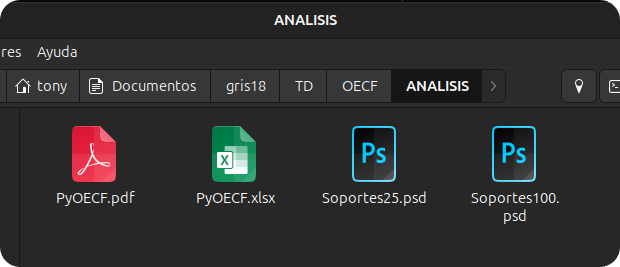

# Análisis del revelado { #revelado }

La información del primer análisis representa el comportamiento del sensor, pero la imagen que contiene no deja de ser una *imagen latente*, la cual debe ser procesada por un revelador. La diferencia entre el procesado del revelador y la imagen latente puede ser analizada sin problemas por este software, pero hay que realizar un proceso manual, ya que el software no puede revelar las imágenes exactamente como lo haría el revelador que se utilice por parte del fotógrafo.

Para realizar este proceso, se deben seguir estos pasos:

- Se importarán en el editor de preferencia las imágenes renombradas como zonas, que se encuentran en la carpeta `OECF/ZONAS`.
- Se exportan a formato `TIFF` sin realizarles modificación ni revelado alguno.
- Se guardan en la misma carpeta `OECF/ZONAS`, junto a las imágenes de las que proceden y con su mismo nombre de zona: `Z05.tif`, `Z03-3.tif`, etc.
- Se selecciona la carpeta `OECF` en el programa y se pulsa **Analizar revelado**. Antes debe haberse realizado el análisis del sensor.

```text
OECF/
└── ZONAS/
    ├── Z00.CR3
    ├── Z00.tif     ← exportación del revelador, mismo nombre
    ├── …
    ├── Z10.CR3
    └── Z10.tif
```


## Cómo exportar las imágenes

Para que el programa pueda medirlas, las exportaciones deben ser:

- **TIFF de 16 bits**.
- **Sin compresión**.
- **Con el perfil de color incrustado**: sRGB, Adobe RGB o ProPhoto RGB. Sin perfil, el programa no sabe en qué espacio de color está la imagen y no la medirá.
- **A tamaño completo**: sin recortar ni redimensionar.

Los visores de imágenes y los conversores en línea no sirven: suelen exportar a otro tamaño, sin perfil o con compresión. Debe utilizarse un revelador.


## Resultado

El programa mide cada exportación en las mismas zonas de la tarjeta gris que el análisis del sensor y rehace con ello la hoja de cálculo y el PDF. Si el análisis encontró el paño gris, ofrece además generar los archivos PSD con las texturas reveladas.


## Qué conservar

- Una vez terminado, basta con conservar el archivo `estudio.json` y la carpeta `ZONAS`: con ellos puede repetirse el análisis del revelado y obtenerse de nuevo la hoja de cálculo, el PDF y los PSD.

- Para repetir también el análisis del sensor, debe conservarse la carpeta `OECF` completa. Si solo interesa el revelado, es suficiente con `estudio.json` y las exportaciones `TIFF`, juntos en una misma carpeta.

- Si sólo desea conectar con `FotoEstacion`, puede conservar únicamente el archivo `estudio.json`.

- De todas, maneras, se recomienda siempre conservar la carpeta `ANALISIS`.

{ .centrada }